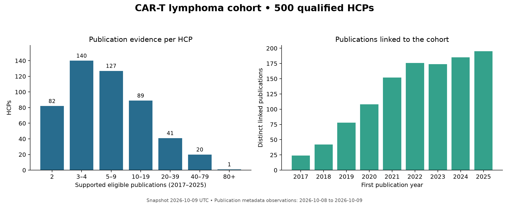

# KOLProject

CAR-T / lymphoma HCP research pipeline for Columbia's AI for Life Sciences project.
The published snapshot includes **500 HCPs**, their publication and coauthorship
evidence, 2024 CMS Open Payments, separate 2024 Medicare utilization tables, and a
2026-10-24 extension that labels 17,510 US hem/onc NPIs as core, affiliate, or
referring around a 173-hospital CAR-T center set.

## Start with uv

Use **uv** for environment management, locked dependency installation, and commands.
The project requires Python 3.12; `.python-version`, `pyproject.toml`, and `uv.lock`
define the environment. Install [uv](https://docs.astral.sh/uv/getting-started/installation/), then:

```bash
git clone https://github.com/Renriviera/KOLProject.git
cd KOLProject
uv sync --locked
uv run kolproject-evaluate
uv run pytest
```

The evaluation checks the published tables and writes
`evaluations/processed_validation.json`. It works offline from a fresh clone.

## Repository structure

| Folder/file | Contents |
|---|---|
| [`Data/processed/`](Data/README.md) | Dated HCP, publication, payment, network, screening, and utilization CSVs |
| `Data/manifests/` | Field dictionaries for the cohort, utilization extension, and HCP divisions |
| [`Data/DIVISIONS_README.md`](Data/DIVISIONS_README.md) | 2026-10-24 CAR-T center set and referring/affiliate HCP division labels around the core 500 |
| `src/kolproject/` | Collection, identity matching, deduplication, preprocessing, analysis, ranking, and evaluation code |
| `pre-processing/` | Payment prefetch and one-to-one modeling join helpers |
| `configs/` | Hydra settings, 2024 code definitions, and identity evidence templates; ignored `configs/local/` holds local evidence |
| [`models/`](models/README.md) | Baseline ranking runs, input hashes, weights, and modeling-input instructions |
| [`models/kol_runs/`](models/kol_runs/README.md) | Leiden communities, three explainable composite KOL scores, and eleven robustness experiments |
| `docs/` | Static GitHub Pages site built from a run: interactive community map, affiliate and referrer catchment graph, experiments, and data sources |
| [`evaluations/`](evaluations/README.md) | Reproducible processed-table checks and historical source-validation reports |
| [`eda/`](eda/README.md) | Cohort summaries, missingness, geographic counts, and network statistics |
| [`eda/visualizations/`](eda/visualizations/README.md) | Publication profile and seeded coauthorship network figures |
| `edav/` | Compatibility note for the original output location; the CLI stage remains `edav` |
| `tests/` | Identity, utilization interpretation, and published-table regression checks |
| `pyproject.toml`, `uv.lock`, `.python-version` | uv project and locked Python environment |

## Reproduce analysis from the published tables

These commands use the processed CSVs included in GitHub and do not fetch source data:

```bash
uv run kolproject stage=edav
uv run kolproject stage=rank
uv run python pre-processing/join_utilization.py
uv run kolproject-kol
uv run kolproject-kol-site models/kol_runs/b96b018dcf02
uv run kolproject-evaluate
```

EDA writes summaries to `eda/` and images to `eda/visualizations/`. Ranking outputs
go to `models/runs/<weight-hash>/`. The join creates an optional descriptive input
in `models/inputs/`, preserving all 500 HCPs and both original source tables.
Derived output timestamps reflect the rerun; source observation dates are preserved.
`kolproject-kol` writes community, composite-score, and robustness outputs to
`models/kol_runs/<run-id>/`; see its [README](models/kol_runs/README.md).
`kolproject-kol-site` turns a run into the static site in `docs/`, published at
https://renriviera.github.io/KOLProject/ when GitHub Pages is enabled.
`uv run kolproject-divisions --skip-collect` rebuilds the 2026-10-24 division tables
from local raw files, and `uv run kolproject-catchment` bundles them into the site's
Catchment tab; see [`Data/DIVISIONS_README.md`](Data/DIVISIONS_README.md). CareSet
DocGraph files, once licensed, load with `uv run kolproject-careset <file> --year 2024`.



## Use the data

Read [`Data/README.md`](Data/README.md) for table relationships and
[`Data/UTILIZATION_README.md`](Data/UTILIZATION_README.md) for utilization definitions.
Keep identifiers as strings:

```python
import pandas as pd

hcps = pd.read_csv("Data/processed/2026-10-09/hcps.csv", dtype={"npi": str, "hcp_id": str})
features = pd.read_csv("Data/processed/2026-10-15/hcp_utilization_features.csv",
                       dtype={"npi": str, "hcp_id": str})
analysis = hcps.merge(features, on=["npi", "hcp_id"], how="left", validate="one_to_one")
```

Do not join detailed service rows directly into a one-row-per-HCP model: doing so
repeats publication and network features. Blank activity values mean unavailable
or unobserved; they must not be filled with zero by default.

## Collection and full source validation

Use one `KOLProject` working folder connected to GitHub. Code, processed tables,
and curated analysis outputs are tracked. Large raw responses, intermediate caches,
legacy seeds, and local identity evidence stay in that same folder and are excluded
by `.gitignore`; there is no separate publication checkout.

The consolidated local project already contains `Data/raw/`, `Data/interim/`, and
`Data/legacy/`. For a fresh clone, restore those directories from a local backup
before full source validation, frozen rebuilds, or collection/resume. Put populated
`affiliation_evidence.csv` and `identity_review.csv` in ignored `configs/local/`.
Each local file takes precedence over the corresponding tracked template in
`configs/`; without a local file, the template is used.

```bash
uv run kolproject stage=validate
uv run kolproject-utilization stage=validate
uv run kolproject stage=rebuild
uv run kolproject-utilization stage=rebuild
# Resume collection only when needed; live upstream observations can change:
uv run kolproject stage=all
uv run kolproject-utilization stage=all
```

The default `kolproject` stage is full source validation; use `kolproject-evaluate`
for the checks available in a GitHub clone. Historical validation reports are kept
in `evaluations/snapshots/` with their original timestamps and scope. The
pre-publication Git history and release tags are preserved in ignored
`.local-backups/consolidation-2026-10-24/original-history.bundle` in the consolidated
local project. That directory also preserves earlier versions of files replaced
during consolidation and the verification inventories. It is a recovery archive,
not a second working copy, and is not included in a fresh clone.

## Interpretation

This is a publication-selected academic cohort, not a representative physician
census. Coauthorship and unfitted baseline rankings describe academic visibility.
CMS Open Payments represents industry transfers of value; Medicare utilization is
published aggregate service activity. Neither establishes prescribing influence,
clinical quality, patient copays, individual patient activity, or causal effects.
2026-observed features must not be used as prospective predictors of 2024 activity.
Third-party source content retains its original terms.
