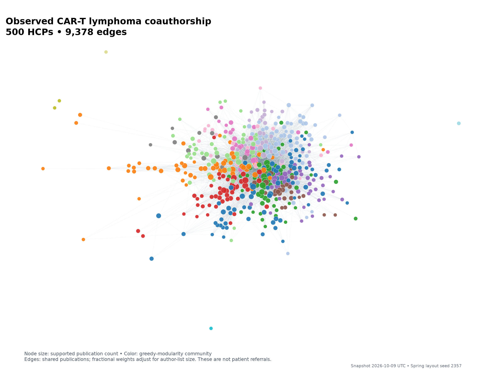

# Visualizations

Rebuild with `uv run kolproject stage=edav` from the repository root. Figures are
saved as PNGs using Matplotlib's noninteractive backend.

## Publication evidence

Shows supported publication counts per HCP and distinct linked publications by year.

## Observed coauthorship

Node size reflects supported publication count; color identifies a
greedy-modularity community. Edges represent observed shared publications with
fractional weights that adjust for author-list size. The NetworkX spring layout
uses seed 2357. Positions and colors have no geographic or clinical interpretation.
Named top-PageRank results are in `../top_pagerank.csv`; network labels are omitted
to avoid overlap. This graph does not represent patient referrals.
